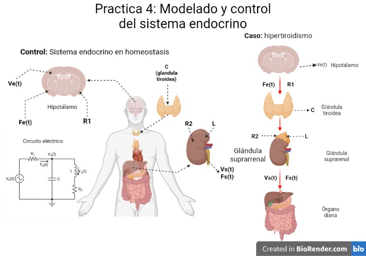
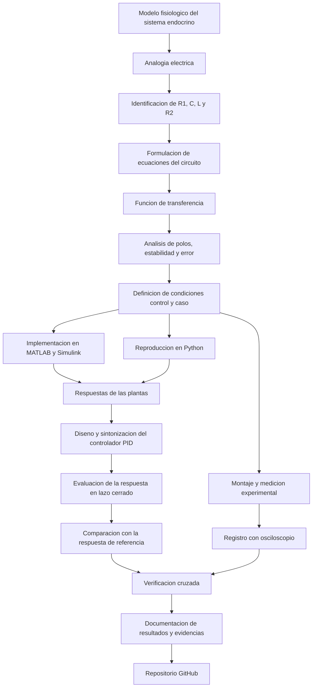

[](https://matlab.mathworks.com/open/github/v1?repo=l23212242-alt/MSFP4)

# Práctica 4: Modelado y control del sistema endócrino


## Datos académicos

**Docente:** Dr. Paul Antonio Valle Trujillo  
**Correo:** [paul.valle@tectijuana.edu.mx](mailto:paul.valle@tectijuana.edu.mx)  
**Departamento:** Ingeniería Eléctrica y Electrónica  
**Institución:** Tecnológico Nacional de México / Instituto Tecnológico de Tijuana  
**Asignatura:** Modelado de Sistemas Fisiológicos  
**Programa:** Ingeniería Biomédica  

**Estudiante:** Javier Vázquez Gómez  
**Matrícula:** 23212242  
**Correo institucional:** [l23212242@tectijuana.edu.mx](mailto:l23212242@tectijuana.edu.mx)  

**Repositorio de la asignatura:** [](https://github.com/DrPaulValle/MSF-IBF1020)  ](https://github.com/DrPaulValle/MSF-IBF1020)

**Sede:** Blvd. Alberto Limón Padilla s/n, Tijuana, C. P. 22454, B. C., México.

## Contenido

1. [Resumen](#resumen)
2. [Competencia y objetivos](#objetivos)
3. [Relación con el temario](#temario)
4. [Modelo físico y analogía eléctrica](#analogia)
5. [Formulación matemática](#modelo)
6. [Análisis temporal y de estabilidad](#analisis)
7. [Señales de entrada y condiciones de simulación](#senales)
8. [Implementación en MATLAB, Simulink y Simscape](#matlab)
9. [Control en lazo cerrado y sintonización PID](#pid)
10. [Reproducción en Python](#python)
11. [Controlador analógico y laboratorio](#laboratorio)
12. [Resultados y verificación cruzada](#resultados)
13. [Flujo de trabajo](#flujo)
14. [Actividades del estudiante](#actividades)
15. [Estructura del repositorio](#estructura)
16. [Requisitos](#requisitos)
17. [Reproducibilidad y entregables](#reproducibilidad)
18. [Referencias](#referencias)

## Resumen

En esta práctica se desarrolla un modelo eléctrico equivalente de segundo orden para representar de manera simplificada la dinámica del sistema endócrino. Se consideran los procesos de secreción, transporte, almacenamiento y respuesta hormonal mediante una fuente de entrada, resistencias, un capacitor y un inductor. Se construyen dos condiciones de operación: control y caso, cuyos parámetros permiten comparar sus respuestas ante una entrada escalón unitario. A partir de las funciones de transferencia se estudian el comportamiento estacionario y la estabilidad, y se diseña un controlador PID para aproximar la respuesta del caso a la respuesta de referencia. El análisis se complementa mediante MATLAB/Simulink, Python y mediciones experimentales con osciloscopio.

**Palabras clave:** sistema endócrino; modelado fisiológico; analogía eléctrica; circuito RLC; función de transferencia; sistema de segundo orden; estabilidad; error en estado estacionario; controlador PID; MATLAB; Simulink; Simscape Electrical; Python; osciloscopio.

## Competencia y objetivos

### Competencia a desarrollar

Modelizar sistemas fisiológicos mediante analogías eléctricas, ecuaciones diferenciales y funciones de transferencia para analizar su comportamiento dinámico y diseñar estrategias de control mediante técnicas de control clásico. En esta práctica se representa de forma simplificada la secreción, el transporte, el almacenamiento y la respuesta hormonal, comparando una condición de referencia con una condición alterada.

### Objetivo general

Formular y analizar un circuito eléctrico equivalente de segundo orden que represente la dinámica simplificada del sistema endócrino, comparar las condiciones control y caso, y diseñar un controlador PID que reduzca la diferencia entre sus respuestas.

### Objetivos específicos

- Identificar la correspondencia entre los procesos hormonales y los elementos del circuito equivalente.
- Obtener las funciones de transferencia de las condiciones control y caso.
- Calcular el error en estado estacionario y analizar los polos de ambos sistemas.
- Simular las respuestas mediante MATLAB/Simulink y Python.
- Sintonizar un controlador PID y evaluar el seguimiento de la respuesta de referencia.
- Contrastar los resultados de simulación con la respuesta observada en el laboratorio.

## Relación con el temario

La práctica se relaciona con los contenidos de modelado matemático de sistemas fisiológicos, análisis de circuitos eléctricos, transformada de Laplace, funciones de transferencia, análisis de estabilidad y control clásico.

| Contenido | Aplicación en la práctica |
|---|---|
| Modelado fisiológico | Representación simplificada de la dinámica hormonal |
| Analogías eléctricas | Equivalencia entre transporte, almacenamiento y respuesta mediante R, C y L |
| Ecuaciones diferenciales | Formulación de las relaciones dinámicas del circuito |
| Transformada de Laplace | Obtención de las funciones de transferencia |
| Sistemas de segundo orden | Análisis de polos y respuesta temporal |
| Control clásico | Diseño y sintonización de un controlador PID |
| Simulación y experimentación | Comparación de MATLAB/Simulink, Python y osciloscopio |

## Modelo físico y analogía eléctrica

El modelo representa un estímulo fisiológico mediante la fuente de voltaje de entrada $V_e(t)$. La resistencia $R_1$ representa la oposición efectiva asociada al transporte hormonal. El capacitor $C$, conectado desde el nodo de salida a la referencia, representa el almacenamiento temporal de la señal. La rama formada por el inductor $L$ y la resistencia $R_2$, conectados en serie, representa la dinámica retardada y la oposición asociada con la respuesta del tejido u órgano diana.

La salida $V_s(t)$ se mide en el nodo posterior a $R_1$, común al capacitor y a la rama $L-R_2$. El flujo de entrada se representa mediante $F_e(t)$, mientras que el flujo de salida se representa mediante $F_s(t)$. La analogía es fenomenológica: reproduce propiedades dinámicas como almacenamiento, disipación, retardo e inercia, sin establecer una equivalencia directa entre los componentes eléctricos y parámetros fisiológicos medidos.

### Parámetros utilizados en las simulaciones

| Componente | Control | Caso |
|---|---:|---:|
| $R_1$ | 1 kΩ | 1 kΩ |
| $L$ | 100 mH | 100 mH |
| $C$ | 1 µF | 1000 µF |
| $R_2$ | 100 kΩ | 1 kΩ |

La modificación de $C$ y $R_2$ permite comparar una condición de referencia con una condición alterada.

### Diagrama BioRender del sistema endócrino

El siguiente diagrama representa la condición de control y el caso de hipertiroidismo, mostrando los órganos y elementos relacionados con el modelo fisiológico.




## Formulación matemática

### 1. Relaciones del circuito equivalente

Aplicando las leyes de Kirchhoff al circuito, las relaciones empleadas son:

$$
V_e(t)=R_1 i_1(t)+\frac{1}{C}\int [i_1(t)-i_2(t)]\,dt
$$

$$
\frac{1}{C}\int [i_1(t)-i_2(t)]\,dt=L\frac{di_2(t)}{dt}+R_2i_2(t)
$$

$$
V_s(t)=L\frac{di_2(t)}{dt}+R_2i_2(t)
$$

### 2. Función de transferencia

Aplicando la transformada de Laplace con condiciones iniciales nulas, se obtiene la función de transferencia entre la salida y la entrada:

$$
G(s)=\frac{V_s(s)}{V_e(s)}=
\frac{Ls+R_2}{R_1LCs^2+(L+R_1R_2C)s+(R_1+R_2)}
$$

Para la condición control, con $R_1=1\,k\Omega$, $L=0.1\,H$, $C=1\,\mu F$ y $R_2=100\,k\Omega$:

$$
G_{control}(s)=\frac{0.1s+100000}{0.0001s^2+100.1s+101000}
$$

Para la condición caso, con $R_1=1\,k\Omega$, $L=0.1\,H$, $C=1000\,\mu F$ y $R_2=1\,k\Omega$:

$$
G_{caso}(s)=\frac{0.1s+1000}{0.1s^2+1000.1s+2000}
$$

### 3. Representación dinámica

La presencia de dos elementos independientes de almacenamiento de energía, el capacitor y el inductor, establece un modelo de segundo orden. Las funciones de transferencia se implementan en Python mediante `control.tf` y se utilizan como base para las simulaciones de las condiciones control y caso.

## Análisis temporal y de estabilidad

### 1. Respuesta estacionaria

Para una entrada escalón unitario, la ganancia en estado estacionario se obtiene evaluando la función de transferencia en $s=0$:

$$
G(0)=\frac{R_2}{R_1+R_2}
$$

Por tanto, el error en estado estacionario respecto a una entrada unitaria es:

$$
e_{ss}=1-G(0)=\frac{R_1}{R_1+R_2}
$$

| Condición | Ganancia final | Error en estado estacionario |
|---|---:|---:|
| Control | 0.990099 | 0.009901 (aprox. 0.99 %) |
| Caso | 0.5 | 0.5 (50 %) |

La diferencia entre las salidas finales de control y caso es aproximadamente 0.490099.

### 2. Polos y estabilidad

Los polos se obtienen a partir de las raíces del denominador de cada función de transferencia. Para la condición control, los coeficientes del denominador son $0.0001$, $100.1$ y $101000$; para el caso son $0.1$, $1000.1$ y $2000$. En ambos sistemas los polos se localizan en el semiplano izquierdo del plano complejo, por lo que las dos condiciones son estables.

### 3. Interpretación de la respuesta

La condición control presenta una ganancia final cercana a la unidad, mientras que la condición caso alcanza aproximadamente la mitad de la amplitud de la entrada. La diferencia entre ambas respuestas evidencia el efecto de modificar los parámetros de almacenamiento y disipación del modelo.

## Señales de entrada y condiciones de simulación

La señal de entrada utilizada es un escalón unitario:

$$
V_e(t)=u(t)
$$

La simulación numérica en Python utiliza un intervalo de 0 a 10 segundos, con un paso de muestreo de $1\times10^{-3}$ s, equivalente a 10001 muestras. En MATLAB/Simulink se utiliza un tiempo de simulación de 10 s, el solucionador `ode15s` y un paso máximo de `1e-3` s.

## Implementación en MATLAB, Simulink y Simscape

El modelo se implementa en el archivo `sistema.slx`, que contiene las representaciones de las condiciones control y caso y el bloque de control PID. La ejecución desde MATLAB se realiza mediante el siguiente procedimiento:

```matlab
clc; clear; close all; warning('off','all')
open_system('sistema')
parameters.StopTime = '10';
parameters.Solver = 'ode15s';
parameters.MaxStep = '1e-3';
x = sim('sistema',parameters);
```

Los resultados se organizan mediante las señales de control, caso, tratamiento PID y entrada. El cuaderno `Vazquez23212242(2).mlx` documenta la ejecución y la representación de las respuestas.

### Ejecución desde el cuaderno MATLAB

Abrir el archivo `Vazquez23212242(2).mlx`, verificar que `sistema.slx` se encuentre en la misma carpeta de trabajo y ejecutar las secciones del cuaderno. La simulación se configura para un horizonte de 10 segundos con `ode15s` y un paso máximo de `1e-3` s.

### Representaciones y evidencias

La documentación incluye la gráfica de las respuestas obtenidas en MATLAB/Simulink y las capturas correspondientes a la sintonización PID, la simulación en Python y la medición con osciloscopio.

**Sintonización del controlador en PID Tuner:**


**Respuesta obtenida mediante Python:**


## Control en lazo cerrado y sintonización PID

### 1. Esquema de retroalimentación

La respuesta del sistema en condición control se utiliza como referencia para el sistema en condición caso. El error de seguimiento se define como:

$$
e(t)=V_{s,control}(t)-V_{s,caso}(t)
$$

El controlador PID actúa sobre el sistema caso para aproximar su respuesta a la del sistema de referencia.

### 2. Sintonización del controlador

El controlador se configura en forma PIDF. La captura de PID Tuner muestra los parámetros sintonizados y la comparación entre la respuesta sintonizada y la respuesta del bloque:

| Parámetro | Valor sintonizado mostrado |
|---|---:|
| $P$ | 12109.7648 |
| $I$ | 27157831.1654 |
| $D$ | 0.18118 |
| $N$ | 46303.4996 |

La respuesta sintonizada presenta un tiempo de subida de 0.000143 s, un tiempo de establecimiento de 0.00109 s y un sobreimpulso de 10.2 %, de acuerdo con la ventana de parámetros de PID Tuner.

### 3. Función de transferencia de lazo cerrado

La implementación en Python construye un controlador PID a partir de las ganancias proporcionales, integrales y derivativas y lo conecta en serie con la planta correspondiente al caso. La función de transferencia de lazo cerrado se obtiene mediante realimentación unitaria:

$$
T(s)=\frac{C_{PID}(s)G_{caso}(s)}{1+C_{PID}(s)G_{caso}(s)}
$$

En el código se emplean las ganancias $k_P=13209.9564$, $k_I=32316525.9285$ y $k_D=0.18118$ para la construcción del controlador reproducido en Python.

## Reproducción en Python

El archivo `Vazquez23212242(2).py` reproduce las funciones de transferencia, genera las respuestas de control y caso, construye el controlador PID y representa la respuesta del tratamiento. La señal de entrada se define como un vector de unos, correspondiente al escalón unitario.

### Bibliotecas utilizadas

```python
import numpy as np
import math as m
import control as ctrl
import matplotlib.pyplot as plt
```

El programa define los sistemas mediante la función `sis(C, R2, nombre)`, calcula las respuestas mediante `ctrl.forced_response` y obtiene el sistema de lazo cerrado con `ctrl.feedback`. La figura resultante se guarda como `Control_caso_python4.pdf`.

## Controlador analógico y laboratorio

La práctica contempla la implementación experimental del circuito y la comparación de las respuestas con los resultados de simulación. Se incluye una captura de osciloscopio en la que se observan dos señales de respuesta ante el escalón aplicado. La imagen registra amplitudes pico a pico de aproximadamente 1.080 V y 520.0 mV para los dos canales mostrados.

La comparación experimental permite observar la diferencia de amplitud entre las respuestas y contrastarla con el comportamiento esperado de las condiciones control y caso. La captura se conserva como evidencia de la medición realizada.


## Resultados y verificación cruzada

### Comparación de resultados

| Herramienta | Resultado documentado |
|---|---|
| Análisis matemático | Función de transferencia, polos y error en estado estacionario para control y caso |
| MATLAB/Simulink | Respuestas de control, caso y tratamiento PID durante 10 s |
| PID Tuner | Ganancias PID y métricas de respuesta temporal |
| Python | Reproducción numérica de las funciones de transferencia y del tratamiento PID |
| Osciloscopio | Captura experimental de las respuestas de los dos canales |

### Interpretación

El sistema de control presenta una salida final aproximada de 0.9901 V ante el escalón unitario, mientras que el sistema caso alcanza 0.5 V. El controlador se incorpora para reducir la diferencia entre ambas respuestas. La simulación y la medición experimental permiten examinar el comportamiento del circuito desde representaciones complementarias.

### Consideraciones de verificación

La verificación cruzada considera la consistencia entre el desarrollo matemático, la simulación computacional y las mediciones del osciloscopio. Las diferencias observables pueden analizarse considerando tolerancias de los componentes, características no ideales de los elementos eléctricos y limitaciones de los instrumentos de medición.

## Flujo de trabajo



## Actividades del estudiante

### Etapa 1. Identificación y formulación

- [x] Interpretación de la descripción funcional del sistema endócrino.
- [x] Propuesta del circuito eléctrico equivalente con $R_1$, $C$, $L$ y $R_2$.
- [x] Obtención de las funciones de transferencia para control y caso.
- [x] Cálculo del error en estado estacionario y análisis de estabilidad.

### Etapa 2. Simulación de las condiciones

- [x] Implementación de las condiciones control y caso en MATLAB/Simulink.
- [x] Simulación con entrada escalón unitario.
- [x] Reproducción numérica de las respuestas en Python.

### Etapa 3. Control y reproducción

- [x] Diseño y sintonización del controlador PID.
- [x] Evaluación de la respuesta del sistema controlado.
- [x] Registro de la respuesta experimental mediante osciloscopio.

### Etapa 4. Documentación

- [x] Organización del análisis matemático y de los archivos de simulación.
- [x] Incorporación de las gráficas y capturas de resultados.
- [x] Preparación del README y del archivo de citación del repositorio.

## Estructura del repositorio

```text
MSFP4/
├── README.md
├── CITATION.cff
├── sistema.slx
├── Vazquez23212242(2).mlx
├── Vazquez23212242(2).py
├── Vazquez23212242(2).pdf
├── Analisis_Matematico.pdf
├── Captura_PID.png
├── Captura_Python.png
├── Osciloscopio.png
└── Control_caso_python4.pdf
```

Los nombres del árbol representan la organización propuesta para los archivos de la práctica. Los archivos de imagen deben agregarse al repositorio con los nombres indicados para que se visualicen los enlaces de evidencia.

## Requisitos

### Software

- MATLAB y Simulink.
- Simscape Electrical para la representación del circuito.
- Python 3.
- Bibliotecas de Python: `numpy`, `control` y `matplotlib`.

### Archivos de entrada

- Modelo de Simulink `sistema.slx`.
- Cuaderno MATLAB `Vazquez23212242(2).mlx`.
- Script Python `Vazquez23212242(2).py`.
- Documentación matemática y evidencias experimentales.

## Reproducibilidad y entregables

### Secuencia de reproducción

1. Descargar o clonar el repositorio.
2. Abrir MATLAB y establecer como carpeta de trabajo la ubicación de los archivos.
3. Abrir y ejecutar `Vazquez23212242(2).mlx` para correr el modelo `sistema.slx`.
4. Ejecutar `Vazquez23212242(2).py` en un entorno Python con las bibliotecas indicadas.
5. Comparar las respuestas obtenidas con las gráficas y capturas incluidas.

### Resultados y evidencias

- Análisis matemático del circuito equivalente.
- Funciones de transferencia de las condiciones control y caso.
- Archivos MATLAB, Simulink y Python.
- Gráficas de las respuestas y del tratamiento PID.
- Captura de PID Tuner.
- Captura de la simulación en Python.
- Captura del osciloscopio.
- Archivo `README.md` y `CITATION.cff`.

### Criterios de presentación académica

El repositorio organiza el desarrollo fisiológico, eléctrico, matemático, computacional y experimental de la práctica. Las figuras y archivos complementarios se identifican mediante nombres descriptivos para facilitar su consulta y reproducción.

## Referencias

1. Valle Trujillo, P. A. (2026). *Syllabus para Modelado de Sistemas Fisiológicos*. Tecnológico Nacional de México, Instituto Tecnológico de Tijuana. Sección 5.6: Práctica: Modelado y control del sistema endócrino, pp. 96–105.
2. Khoo, M. C. (2018). *Physiological Control Systems: Analysis, Simulation, and Estimation* (2nd ed.). IEEE Press.
3. Hoppensteadt, F. C., & Peskin, C. S. *Modeling and Simulation in Medicine and the Life Sciences*. Springer.
4. Hall, J. E. (2021). *Guyton and Hall Textbook of Medical Physiology* (14th ed.). Elsevier.
5. Ogata, K. (2010). *Ingeniería de Control Moderna* (5.ª ed.). Pearson Educación.
6. Nise, N. S. (2020). *Control Systems Engineering* (8th ed.). John Wiley & Sons.

## Uso académico

Este repositorio se elaboró con fines académicos para documentar la Práctica 4 de la asignatura Modelado de Sistemas Fisiológicos, correspondiente al modelado y control del sistema endócrino. El contenido presenta el desarrollo matemático, las simulaciones y las evidencias utilizadas durante la práctica.
